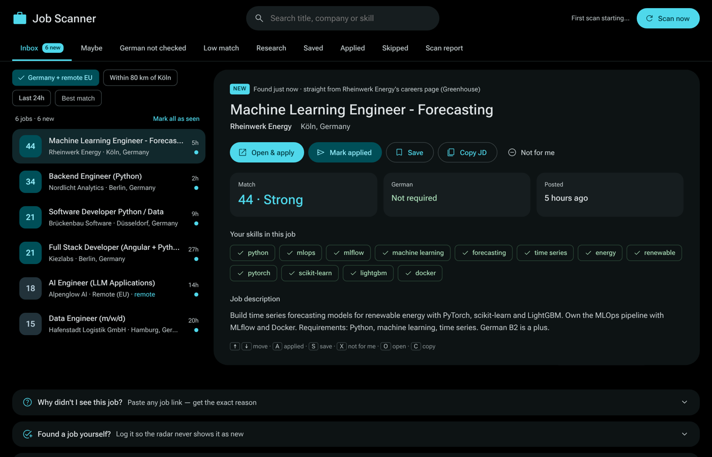
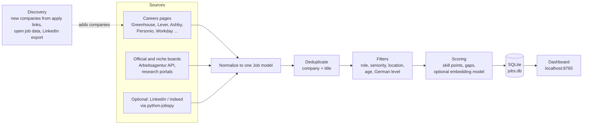

# Job Scanner

[](https://github.com/abhishekchugh707/job-scanner/actions/workflows/tests.yml)


Finds new software jobs in Germany straight from company careers pages, often hours or days before they show up on LinkedIn, and ranks them against your skills in a local dashboard.

I built it during my own job search after noticing that LinkedIn and Indeed often listed jobs days after the company had published them. Job Scanner reads the hiring platforms behind careers pages directly, filters out what doesn't fit (wrong role, wrong seniority, fluent German required, too old) and shows the rest with a match score and the skills that matched.


*Dashboard with demo data (fictional companies).*

## What it does

- **Reads careers pages directly.** About 185 companies through the public job feeds of their hiring platform: Greenhouse, Lever, Ashby, Personio, SmartRecruiters, Recruitee, Workable, JOIN, Workday and Eightfold. A job appears in the dashboard minutes after the company publishes it.
- **Adds official and niche boards.** The Bundesagentur für Arbeit API, German startup and tech boards, and research job portals (Fraunhofer, DLR, DFKI, TUM, RWTH, service.bund.de, academics.de) for PhD and research roles.
- **Finds new companies on its own.** When a job board shows a matching job whose apply link leads to a readable careers feed, that company is added and read directly from then on. It can also search an open dataset of 1.4M jobs, and the companies in your own LinkedIn connections export, for careers feeds.
- **Filters like a recruiter would.** Role keywords, seniority words, location (Germany or remote EU, with a gazetteer of 37k German place names), posting age, and a German-language check that drops ads asking for fluent or C1/C2 German and flags B2.
- **Scores the match.** Weighted skill points from the title and requirements, penalties for core technologies you don't have and for senior-level experience requirements. An optional small multilingual embedding model (multilingual-e5-small, runs on the CPU) gives a second opinion on jobs whose title doesn't use your role words.
- **Deduplicates.** The same job found on several sites is shown once, with the company's own page preferred over job boards.
- **Explains itself.** "Why didn't I see this job?" takes any job link and reports exactly which filter dropped it. The Scan report tab shows every source with its counts and every filtered-out job with the reason.
- **Tracks your applications.** Mark jobs as applied, saved or skipped; the mark follows the job across all its copies.

## How it works



Each source returns the same `Job` dataclass (`jobfinder/models.py`), so filtering, scoring and storage don't care where a job came from. Feeds of the same platform are read a few at a time to stay polite and avoid rate limits.

## Quick start

Requires Python 3.12 or newer.

```bash
git clone https://github.com/abhishekchugh707/job-scanner.git
cd job-scanner
pip install -r requirements.txt

python run.py --check        # test every company feed in companies.yaml once
python app.py --open         # start the dashboard at http://localhost:8765
```

The dashboard scans in the background (every 20 minutes by default) and only shows jobs you haven't seen before.

**One-off scan without the dashboard:**

```bash
python run.py --open         # scan once and open an HTML report
python run.py --days 7       # look back further than the default 2 days
```

**Windows autostart:** run `setup_autostart.bat` once and the scanner starts with Windows and scans in the background; `find_jobs.bat` opens the dashboard. `remove_autostart.bat` undoes it.

## Make it yours

Everything is in two YAML files; no code changes needed.

- **`config.yaml`:** your role keywords, excluded title words, location and radius, skills with weights, technologies you don't have, and which boards to read. The example is set up for a Python / ML / backend profile.
- **`companies.yaml`:** the careers pages to read. Add a company by pasting its careers page:

  ```bash
  python detect_ats.py "Company Name" https://company.com/careers
  ```

  It detects the hiring platform and appends the company. `--file urls.txt` adds many at once.

**Optional sources**

- **LinkedIn, Indeed and Google Jobs** (`boards.jobspy`) are off by default. These sites limit automated access, so check their terms before turning it on, then `pip install python-jobspy`.
- **Your LinkedIn network:** put LinkedIn's connections export at `network/connections.csv` and the scanner checks those companies for careers feeds and shows who you know there. The file stays local and is ignored by git.
- **Skills model:** on by default (`skills_model.enabled`). It installs its dependencies and downloads the model (~120 MB) on first use; set it to `false` to skip that. To tune its cut-off to your taste, add `jobfinder/data/calibration.json` with your yes/no answers for a few borderline jobs; without it, keyword points decide alone.

## Tests

```bash
pip install -r requirements-dev.txt
python -m pytest -q
```

129 tests cover the feed parsers, filters, German-level check, scoring, deduplication, the database and discovery. They run on every push via GitHub Actions on Python 3.12 and 3.13.

## Project structure

```
jobfinder/
  sources/ats.py      readers for each hiring platform (Greenhouse, Lever, Ashby ...)
  sources/boards.py   job boards and research portals
  filters.py          role, seniority, location, age filters and skill scoring
  language.py         German-level check
  semantic.py         optional embedding model
  discover.py         finds new companies to read
  network.py          LinkedIn connections export
  opendata.py         open job dataset
  db.py               SQLite storage and application status
  scan.py             one full scan, start to finish
  why.py              "why didn't I see this job?"
  web/dashboard.html  the dashboard (single file, no build step)
app.py                dashboard server and background scanner
run.py                command-line scan
detect_ats.py         add companies by careers page URL
```

## Notes

- Uses only public job feeds and official APIs by default. Please keep the request rates modest and respect each site's terms.
- Place names: GeoNames (geonames.org), CC BY 4.0.

## License

MIT
